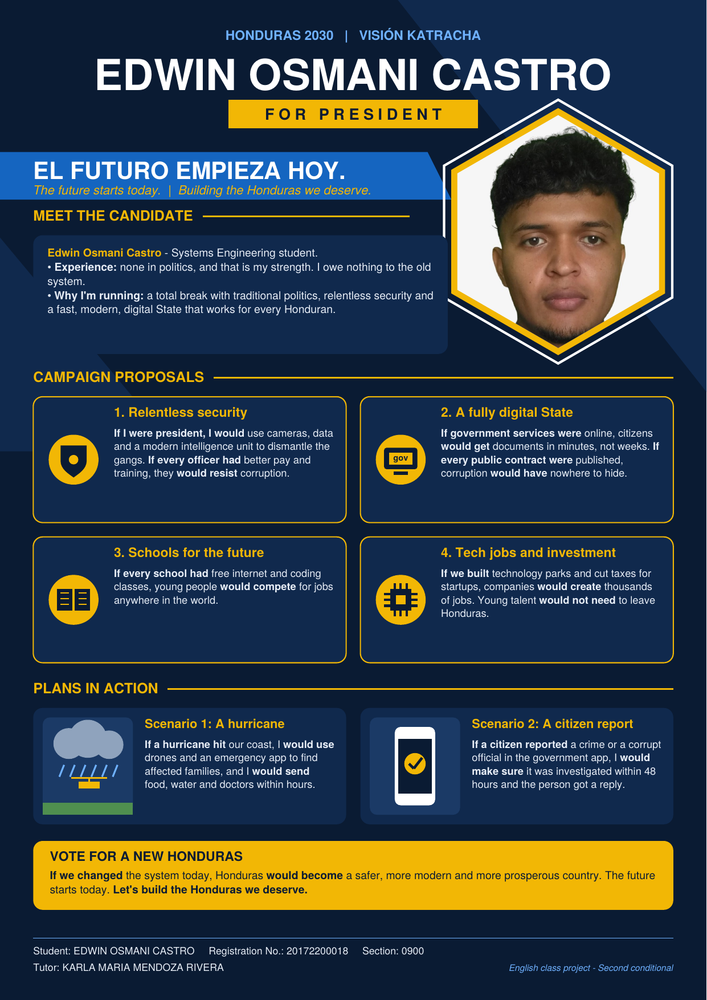
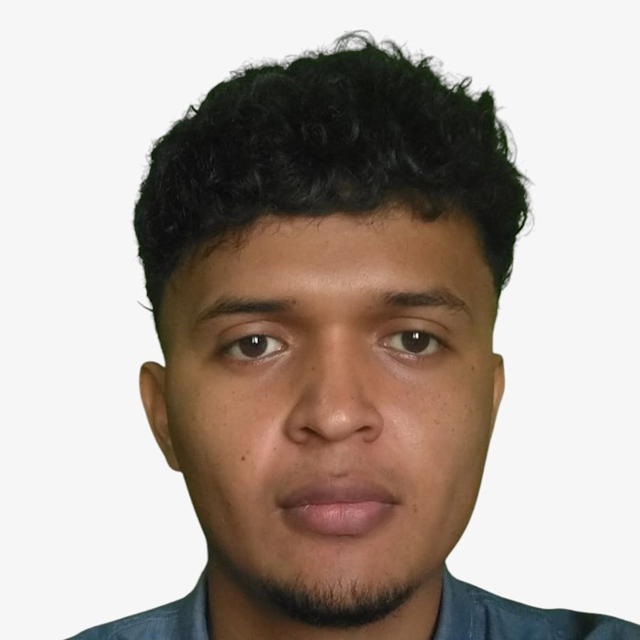

# HONDURAS 2030 | VISIÓN KATRACHA
### Edwin Osmani Castro for President

**"El futuro empieza hoy."** (The future starts today.)
*Alternative slogan: "Construyendo la Honduras que merecemos."*

[Download the poster (PDF)](Honduras2030_Campaign_Poster.pdf)

---

## Student information

| | |
|---|---|
| **Student** | EDWIN OSMANI CASTRO |
| **Registration No.** | 20172200018 |
| **Section** | 0900 |
| **Tutor** | KARLA MARIA MENDOZA RIVERA |
| **Assignment** | Presidential Campaign Poster - Second conditional |

---

## Background

**Edwin Osmani Castro** is a Systems Engineering student.

- **Experience:** none in politics, and that is my strength. I owe nothing to the old system.
- **Why I'm running:** a total break with traditional politics, relentless security and a fast, modern, digital State that works for every Honduran.

 

---

## Campaign proposals

### 1. Relentless security
- **If I were president, I would** use cameras, data and a modern intelligence unit to dismantle the gangs.
- **If every officer had** better pay and training, they **would resist** corruption.

### 2. A fully digital State
- **If government services were** online, citizens **would get** documents in minutes, not weeks.
- **If every public contract were** published, corruption **would have** nowhere to hide.

### 3. Schools for the future
- **If every school had** free internet and coding classes, young people **would compete** for jobs anywhere in the world.

### 4. Tech jobs and investment
- **If we built** technology parks and cut taxes for startups, companies **would create** thousands of jobs.
- Young talent **would not need** to leave Honduras.

---

## Plans in action

### Scenario 1: A hurricane
**If a hurricane hit** our coast, I **would use** drones and an emergency app to find affected families, and I **would send** food, water and doctors within hours.

### Scenario 2: A citizen report
**If a citizen reported** a crime or a corrupt official in the government app, I **would make sure** it was investigated within 48 hours and the person got a reply.

---

## Conclusion

**If we changed** the system today, Honduras **would become** a safer, more modern and more prosperous country. The future starts today. **Let's build the Honduras we deserve.**

---

Fictional campaign created for an English class project (second conditional).
